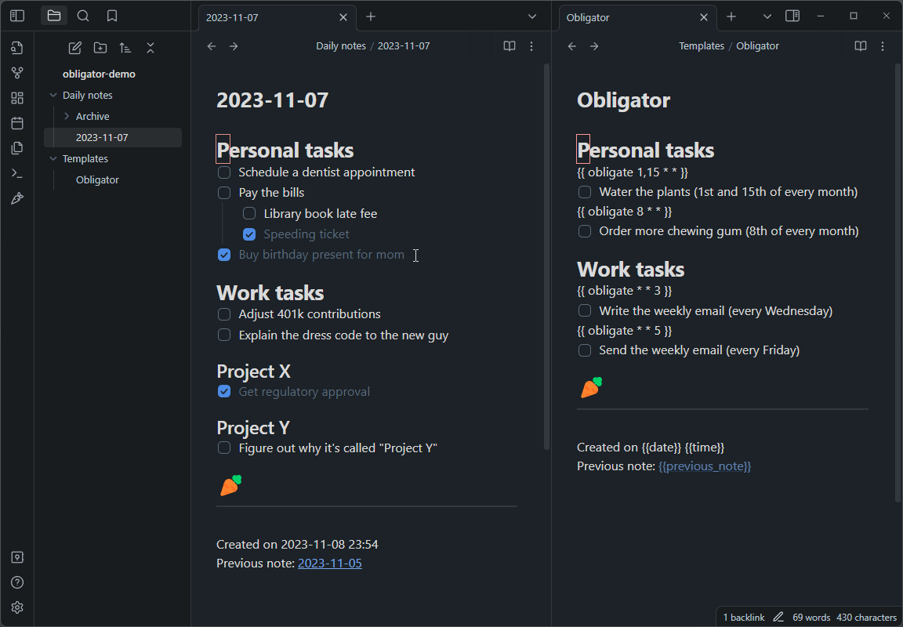
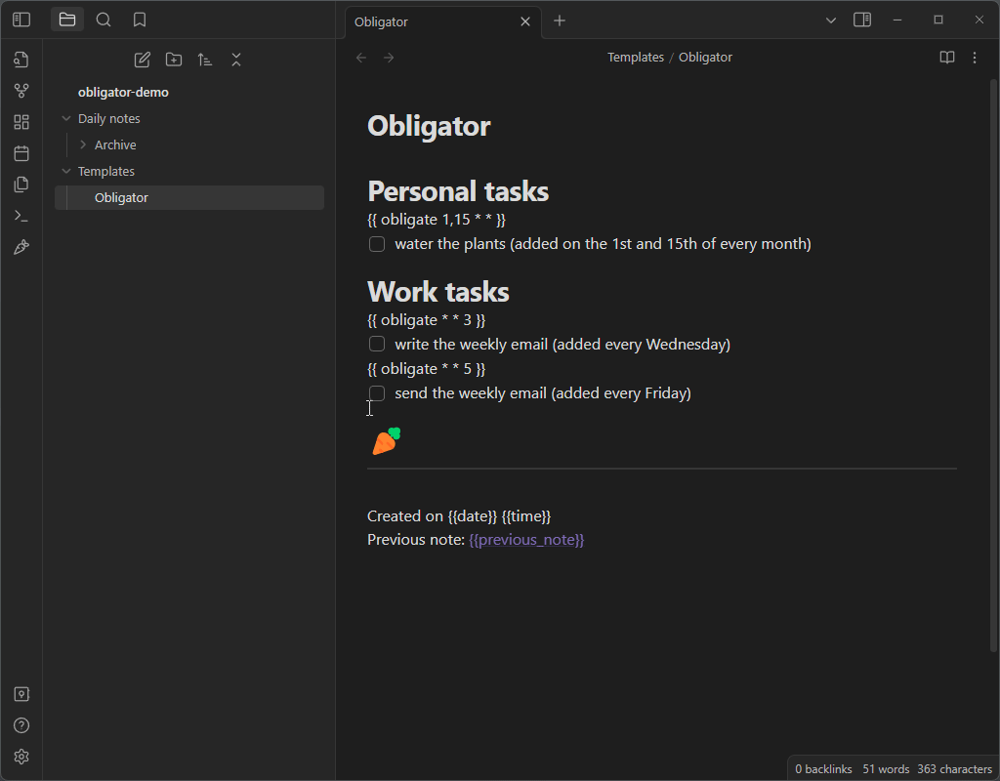
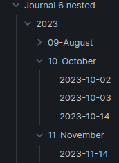

# Daily Todos

Daily Todos replaces and extends the function of the built in `Daily notes` plugin.
Unchecked to-do items will be rolled over to the new daily note, along with all
of the headings and formatting structure you used to organize them, and any
scheduled notes that you've set up. It is a convenient way to manage your
to-do list, and leaves you with running history of notes that you can
reference if you want to.



## How to use Daily Todos

Make sure you have fully filled out the settings page, then click the carrot
icon on the sidebar to open your daily note. If today's note doesn't already
exist, a new note file will be made reflecting today's date. If it does exist,
it will simply bring you to the existing file -- so feel free to click that
carrot to your hearts content.

See the [example template file](example/daily_note.md) for some inspiration on
how to set up your daily note. Here is an animation showing a valid template and
a how to set up the settings properly with that template:



### Nested folder date format
You may use a directory structure in your date format, for example:
`YYYY/MM-MMMM/YYYY-MM-DD`. This will create notes in a structure that looks
something like this:



The archive function will not delete directories if you use this in combination
with a nested directory structure. I suggest only using a nested structure for
the archive date format.

### Moving to-dos out of the previous note
By default Daily Todos *moves* unfinished to-dos: they are added to the new note
and removed from the previous one, so the previous note becomes a record of what
was completed. An unfinished to-do is removed together with everything nested
under it, while completed to-dos and the rest of the note stay in place. Turn
off "Move to-dos to the new note" in the advanced settings if you would rather
keep a copy in both notes.

Two optional settings narrow what gets rolled over, which is useful when a to-do
already lives in the template (habits, for instance):

* **Don't rollover todos from template** - if an unfinished to-do in the
  previous note has the same text as an unfinished to-do in the template, the
  previous copy is not rolled over. The new note simply uses the template's
  version, so the to-do no longer appears twice. The comparison ignores the
  bullet, the checkbox state and indentation, so yesterday's
  `- [x] Wake early !STREAK` still matches the template's
  `- [ ] Wake early !STREAK`; the rest of the text must match exactly.
  * **Only !STREAK tagged Todos** - a sub-option indented under the toggle
    above (it stays disabled until the parent is on). It narrows the rule to
    `!STREAK` lines only: a matching habit is left behind, while every other
    to-do rolls over as usual. This keeps habit lines entirely template-driven
    without affecting the rest of the list. Habits which do not appear in the
    template are not matched, so they still roll over.

Excluded to-dos are also kept in the previous note when "Move to-dos to the new
note" is on, together with everything nested under them, so nothing is lost.
To-dos that are not excluded keep rolling over as usual.

### Template macros
 * {{date}}, {{time}}, and {{title}} work as they normally would.


 * {{previous_note}} and {{previous_note_path}} create back-links to the
   previous note from the current note. If there is no previous note, then
   these variables will be blank.

 * {{next_note}} and {{next_note_path}} create forward-links to the
   next note from the last note. These are added to the last note only when a
   new note is made.

 * `{{ obligate * * * }}` is the original cron-style macro. It uses three fields:
    * day-of-the-month, 
    * month-of-the-year, and 
    * day-of-the-week in that order. 
    * See [crontab.guru](https://crontab.guru) to play around with the syntax. You can also use step values with `/` (e.g. `{{ obligate 1/3 * * }}`).

 * `{{ every ... }}` is a more readable macro for recurring tasks. It will add the immediately proceeding line if the date matches **for any day between your last note and today**. See the [example template file](example/daily_note.md) for examples.

   **Every day:**
   * `{{ every day }}` - every day
   * `{{ every day 2 }}` - day 2 of the month
   * `{{ every day 1,3,5 }}` - days 1, 3, and 5 of the month
   * `{{ every day 1-10 }}` - days 1 through 10 of the month
   * `{{ every 2 day }}` - every 2nd day of the month
   * `{{ every 1/3 day }}` - every 3rd day-of-month starting from the 1st

   **Every specific day of week or month:**
   * `{{ every monday }}`, `{{ every tuesday }}`, ..., `{{ every sunday }}` - every specific weekday
   * `{{ every january }}`, `{{ every february }}`, ..., `{{ every december }}` - first day of every specific month

   **Every week:**
   * `{{ every week }}` - every first day of the week (Monday)
   * `{{ every week 1 }}` - every first day of week 1
   * `{{ every week 1,3 }}` - first day of week 1 and 3
   * `{{ every week 1-3 }}` - first day of week 1 through 3
   * `{{ every 2 week }}` - every 2nd week of the month
   * `{{ every 2/2 week }}` - every 2nd week of the month starting from week 2

   **Every month:**
   * `{{ every month }}` - every first day of the month
   * `{{ every month 1 }}` - the first day on January
   * `{{ every month 1,3 }}` - the first day on January and March
   * `{{ every month 1-3 }}` - every first day on January through March
   * `{{ every 3 month }}` - every 3rd month of the year
   * `{{ every 5/3 month }}` - every 3rd month of the year starting from month 5

   **Every year:**
   * `{{ every year }}` - every first day of the year
   * `{{ every year 2029 }}` - the first day of 2029
   * `{{ every year 2026,2028 }}` - the first day of 2026 and 2028
   * `{{ every year 2026-2028 }}` - every first day of 2026 through 2028
   * `{{ every 2026/3 year }}` - every 3rd year starting from 2026

### Habit streaks
Append the `!STREAK` tag to any to-do and Daily Todos will replace the tag with a
streak pill - in both reading view and live preview (live preview widgets are not
shown in source mode). The `!STREAK` text itself stays hidden and only the pill is
visible:

```markdown
- [ ] Wake early !STREAK
```

renders as:

```
- [ ] Wake early  3
```

The pill shows a flame icon (from Lucide / Obsidian) alongside the streak count (`0`, `1`, `3`, ...), sized to
fit roughly where the `!STREAK` tag was. The tag may appear anywhere in the line,
so `- [x] !STREAK Wake early` works too, and the habit name is everything else on
the line (case-insensitive, whitespace collapsed). So `Wake early` and
`wAke eaRly` are the same habit.

The pill is a replacement for the tag, not an addition to it, so the caret
never ends up in the middle of hidden text. In live preview the raw `!STREAK` is
shown instead of the pill while the cursor is on the tag itself - the same way
live preview reveals a task's `- [ ]` marker when you edit it. The space before
or after the tag does not count. Move the cursor away and the pill comes back.

The streak updates the moment a checkbox changes state - no waiting for the note
to be saved or the view to be re-rendered. It counts consecutive completed days
ending today: today's own checkbox adds one when checked, then the walk continues
into the previous daily note and keeps going for as long as a note exists,
contains the same habit, and has it checked. The first missing or unchecked day
stops the count, and the pill reads `0` when there is nothing to count. So
ticking today's box turns `0` into `1` (or adds one to an existing streak),
and unchecking it takes the number back down.

Only the `- [x]` state counts as completed. A cancelled `- [-]` box stops the
streak, just like an empty one.

The pill takes its corner radius from the active theme (`--tag-radius`), so it
matches the theme's own tags. When checked, the pill is gray and the flame is filled with the tier colour:

| Streak    | Flame colour | CSS variable (default)                 |
| --------- | ------------ | -------------------------------------- |
| 0-29      | silver/white | `--habit-streak-tier-0` (`#f4f4f5`)    |
| 30-89     | yellow       | `--habit-streak-tier-30` (`--color-yellow`) |
| 90-364    | orange       | `--habit-streak-tier-90` (`--color-orange`) |
| 365-999   | red          | `--habit-streak-tier-365` (`--color-red`)   |
| 1000+     | purple       | `--habit-streak-tier-1000` (`--color-purple`)|

While the box is unticked (or cancelled), the pill displays as a darker gray with a gray flame. If the streak data is 0, the flame renders as a gray outline flame.

Each tier is exposed as `.habit-streak[data-tier="..."]` and the pending state as
`.habit-streak[data-state="open"]` (checked pills use `data-state="checked"`), so
a CSS snippet can recolour any of them without changing the plugin. The
`--habit-streak-nudge` variable is there for the rare theme font that needs the
pill shifted a pixel up or down.

### Due date and due time pills

Add a due date or a due time to a to-do line with an `!` token. Daily Todos
replaces the token with a coloured pill in both reading view and live preview,
just like the habit streak pill. Date pills carry a calendar-clock icon and time
pills a plain clock. Due pills are only drawn on to-do / checkbox lines, so
prose, headings and code blocks are left alone.

**Completion date and time**

When a to-do is checked, Daily Todos appends the real completion day to a due
date token and the real completion time to a due time token:
`!10/12/2026@12/12/26` (due date / completion date), `!10:00@10:30` (due time /
completion time) and `!12:00-15:00@14:00` for a time range. When a line has both
a date and a time, each token gets its own completion marker. Completed tasks
show a green pill with the completion date or time. Unchecking the task removes
the `@...` markers again. The completion date and time are the real moment you
checked the task, not the daily note's date.

To-dos without any due date or due time are handled by two settings:

| Setting | Default | Adds |
| ------- | ------- | ---- |
| Append completion date | on | `!@12/12/26` |
| Append completion time | off | `!@10:30` |

With both on, a to-do becomes `- [x] File taxes !@12/12/26 !@10:30`. With both
off, checking the to-do adds no marker. These settings never affect to-dos that
already carry a due date or due time: those are always stamped as described
above.

**Due dates**

| You write | Meaning |
| --------- | ------- |
| `!2026-10-10` | 10 October 2026 (`YYYY-MM-DD` or `YYYY/MM/DD`) |
| `!10-12-2026` | 10 December 2026 (`DD-MM-YYYY` or `DD/MM/YYYY`) |
| `!10/12/26` | 10 December 2026 (`DD/MM/YY`, two-digit years are 20xx) |
| `!today` | the note's own date (or the current day outside daily notes) |
| `!tomorrow` | the day after the note's date |
| `!yesterday` | the day before the note's date |
| `!upcoming` | no specific date yet |

**Due times**

| You write | Meaning |
| --------- | ------- |
| `!15:30` | 15:30 on the note's date |
| `!10:15:30` | 10:15:30 on the note's date |

A date and a time can be combined on one line, in any order. The line's first
date supplies the day for its time tokens, so this is due at 10:10 on 10 October
2026:

```markdown
- [ ] Ship the release !10/12/2026 !10:10
```

A bare time belongs to the note's own date (today outside daily notes). If that
time has already passed, the pill counts as overdue.

The aliases are relative to the date of the daily note they are written in, not
to the moment you happen to open it. `!today` in a note dated 10 October always
means 10 October, even if you read that note a week later; notes outside the
daily-note folder fall back to the real current date.

When a to-do rolls into the next daily note its relative aliases are rewritten
so the due day does not drift:

| In the previous note | In the new note |
| -------------------- | --------------- |
| `!tomorrow` | `!today` |
| `!today` | `!yesterday` |
| anything further apart | `!YYYY-MM-DD` (absolute) |

Absolute dates, times and `!upcoming` are never rewritten, and to-dos which the
template provides keep the template's own wording (so a template habit due
`!today` is due today again on every new note).

**Wording**

**Settings > Due date text** chooses how due date pills are worded. There are
four variations:

| Variation | Example |
| --------- | ------- |
| Exact date | `Due Jan 1, 2026` |
| Relative | `Due Today`, `Due This Week`, `Due Next Year` |
| Days countdown | `Due in 67 Days` |
| Relative countdown | `Due in 2 Years`, `Due in 3 Months`, `Due in 3 Weeks`, `Due in 10 Days` |

The **Exact date format** sub-setting controls the moment format used by exact
date pills (default `MMM D, YYYY`). It is disabled unless Exact date is selected.

**Settings > Due date text type** sits above Due date text and switches between
`Due` and `Remaining`:

| Date | Due | Remaining |
| ---- | --- | --------- |
| 67 days ahead | `Due in 67 Days` | `67 Days left` |
| 2 months ahead | `Due in 2 Months` | `2 Months left` |
| today | `Due Today` | `Today` |
| 3 days ago | `Overdue by 3 Days` | `3 Days passed` |
| 2 months ago | `Overdue by 2 Months` | `2 Months passed` |

For the Relative variation, `Due` adds the prefix (`Due Today`, `Due This Week`,
...) and `Remaining` drops it (`Today`, `This Week`, ...). Overdue dates read
`Overdue` in both. For Exact date, `Due` adds the prefix and `Remaining` shows
just the formatted date.

`This Week` covers the rest of the current ISO week (Monday to Sunday), followed
by `Next Week`, `This Month`, `Next Month`, `This Year` and `Next Year`. Anything
further ahead reads `Due Later` (or `Later`). Relative countdowns use the largest
calendar unit, and weeks start at two weeks. Due time pills always show the time
(`15:30`, `10:15:30`); `!upcoming` always reads `Upcoming`.

**Colours**

| Tier | Colour |
| ---- | ------ |
| due this month | green |
| due later this week (after tomorrow) | yellow |
| due tomorrow | orange |
| due today | red |
| overdue (including a time that has passed today) | purple |
| `!upcoming` | light grey |
| completed (`!due@comp`, `!@comp` or `!@time`) | green (shows the completion date or time) |
| beyond this month | neutral grey |

The colours come from Obsidian's own palette (`--color-green`, `--color-yellow`,
`--color-orange`, `--color-red`, `--color-purple`) with hex fallbacks, so they
follow the active theme. The corner radius uses `--tag-radius`. Each tier is
available as `.due-pill[data-tier="today"]`, `"tomorrow"`, `"week"`, `"month"`,
`"overdue"`, `"upcoming"`, `"later"` and `"completed"` for CSS snippets.

In live preview the raw token is shown instead of the pill while the selection
touches it, so it stays editable. Move the caret away and the pill returns.

**Sorting rolled-over to-dos by due date**

**Settings > Re-arrange rollovered todos by due date** (on by default) orders
the to-dos under each heading in the new note by their due date, closest first.
A time token breaks ties on the same day, and the whole section - template
to-dos included - is ordered. To-dos without a due date, and `!upcoming` ones,
keep their original order after the dated to-dos. Turn the setting off to keep
the previous note's order.

### Three-state checkboxes
Daily Todos adds a command called **Cycle checkbox state (empty, checked,
cancelled)**. It works like Obsidian's *Toggle checkbox status*, but cycles
through three states:

```
- [ ]   ->   - [x]   ->   - [-]   ->   - [ ]
```

It applies to every line touched by the selection, and it turns plain text or
bullets into checkboxes the same way Obsidian's toggle does. Assign it a hotkey
in **Settings > Hotkeys** and search for *Cycle checkbox state*.

Note that Obsidian reserves `Ctrl+L` / `Cmd+L` for its own two-state toggle. If
you map this command to the same keys, one of the two will win - pick a different
shortcut, for example `Ctrl+Shift+L`.


## Comparison with rollover-daily-todos
I was motivated to create this project because my to-do list is extensive, with
lots of formatting that I wanted to maintain between notes, but rollover-daily-todos
copies *only* the unchecked to-do items and places them all into a specified
header, killing all of the formatting.

Here is a basic overview of the differences between the two:

- Daily Todos rolls over all unchecked to-do items as well as all the formatting
  that wraps them.

- Rollover-daily-todos only copies unchecked to-do items, and places them under
  one heading.

- Daily Todos does not rely on the `Daily notes` or `Periodic notes` plugin.

- Daily Todos has the {{ obligate * * * }} macro for automatically scheduling
  to-do items in new notes.

- Daily Todos has an old note archiving feature to keep your notes directory clean.

- Daily Todos has the ability to delete empty headings to keep your daily note clean.

- Daily Todos deals with nested to-do items hierarchically, so a checked parent with
  any amount of unchecked children will get copied over wholly to preserve the
  structure.

- & More!

## Building
* `npm install` (install dependencies)
* `npm run build` (bundle the JavaScript source into `main.js`)
* restart Obsidian, or toggle on and off the plugin
* For development, `npm run dev` listens for changes and rebuilds automatically.

## Releasing
* `npm version patch` (or `minor` / `major`) -- bumps the version in
  `package.json`, updates `manifest.json` and `versions.json`, commits the
  changes, and creates a git tag named after the version.
* `npm run release` -- builds the plugin and pushes the commit and tag.
* The [release workflow](.github/workflows/release.yml) then builds the plugin
  on GitHub and creates a draft release with `main.js` and `manifest.json`.

Note: `npm version` refuses to run if you have uncommitted changes, so commit
your work first.

## Attributions
* File suggestions code taken from [mirnovov](https://github.com/mirnovov/obsidian-homepage/blob/main/src/suggest.ts)
