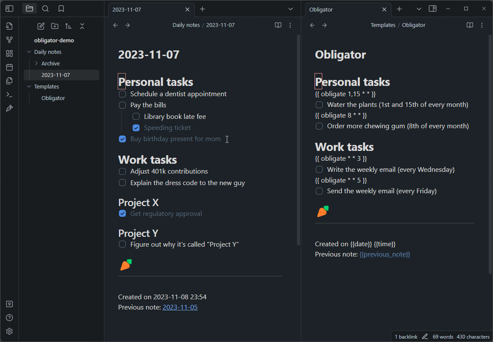
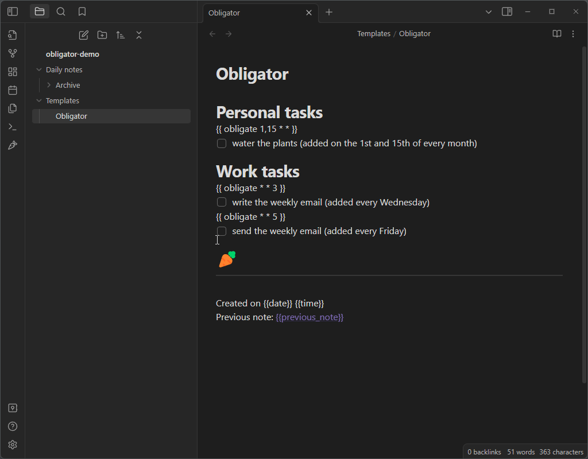
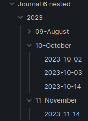

# Daily Todos

Daily Todos replaces and extends the function of the built in `Daily notes` plugin.
Unchecked to-do items will be rolled over to the new daily note, along with all
of the headings and formatting structure you used to organize them, and any
scheduled notes that you've set up. It is a convenient way to manage your
to-do list, and leaves you with running history of notes that you can
reference if you want to.

## How to use Daily Todos

Make sure you have fully filled out the settings page, then click the carrot
icon on the sidebar to open your daily note. If today's note doesn't already
exist, a new note file will be made reflecting today's date. If it does exist,
it will simply bring you to the existing file -- so feel free to click that
carrot to your hearts content.

See the [example template file](example/daily_note.md) for some inspiration on
how to set up your daily note. Here is an animation showing a valid template and
a how to set up the settings properly with that template:

### Nested folder date format
You may use a directory structure in your date format, for example:
`YYYY/MM-MMMM/YYYY-MM-DD`. This will create notes in a structure that looks
something like this:

The archive function will not delete directories if you use this in combination
with a nested directory structure. I suggest only using a nested structure for
the archive date format.

### Moving to-dos out of the previous note
By default Daily Todos *moves* unfinished to-dos: they are added to the new note
and removed from the previous one, so the previous note becomes a record of what
was completed. An unfinished to-do is removed together with everything nested
under it, while completed to-dos and the rest of the note stay in place. Turn
off "Move to-dos to the new note" in the advanced settings if you would rather
keep a copy in both notes.

### Template macros
 * {{date}}, {{time}}, and {{title}} work as they normally would.

 * {{previous_note}} and {{previous_note_path}} create back-links to the
   previous note from the current note. If there is no previous note, then
   these variables will be blank.

 * {{next_note}} and {{next_note_path}} create forward-links to the
   next note from the last note. These are added to the last note only when a
   new note is made.

 * `{{ obligate * * * }}` is the original cron-style macro. It uses three fields:
    * day-of-the-month, 
    * month-of-the-year, and 
    * day-of-the-week in that order. 
    * See [crontab.guru](https://crontab.guru) to play around with the syntax. You can also use step values with `/` (e.g. `{{ obligate 1/3 * * }}`).

 * `{{ every ... }}` is a more readable macro for recurring tasks. It will add the immediately proceeding line if the date matches **for any day between your last note and today**. See the [example template file](example/daily_note.md) for examples.

   **Every day:**
   * `{{ every day }}` - every day
   * `{{ every day 2 }}` - day 2 of the month
   * `{{ every day 1,3,5 }}` - days 1, 3, and 5 of the month
   * `{{ every day 1-10 }}` - days 1 through 10 of the month
   * `{{ every 2 day }}` - every 2nd day of the month
   * `{{ every 1/3 day }}` - every 3rd day-of-month starting from the 1st

   **Every specific day of week or month:**
   * `{{ every monday }}`, `{{ every tuesday }}`, ..., `{{ every sunday }}` - every specific weekday
   * `{{ every january }}`, `{{ every february }}`, ..., `{{ every december }}` - first day of every specific month

   **Every week:**
   * `{{ every week }}` - every first day of the week (Monday)
   * `{{ every week 1 }}` - every first day of week 1
   * `{{ every week 1,3 }}` - first day of week 1 and 3
   * `{{ every week 1-3 }}` - first day of week 1 through 3
   * `{{ every 2 week }}` - every 2nd week of the month
   * `{{ every 2/2 week }}` - every 2nd week of the month starting from week 2

   **Every month:**
   * `{{ every month }}` - every first day of the month
   * `{{ every month 1 }}` - the first day on January
   * `{{ every month 1,3 }}` - the first day on January and March
   * `{{ every month 1-3 }}` - every first day on January through March
   * `{{ every 3 month }}` - every 3rd month of the year
   * `{{ every 5/3 month }}` - every 3rd month of the year starting from month 5

   **Every year:**
   * `{{ every year }}` - every first day of the year
   * `{{ every year 2029 }}` - the first day of 2029
   * `{{ every year 2026,2028 }}` - the first day of 2026 and 2028
   * `{{ every year 2026-2028 }}` - every first day of 2026 through 2028
   * `{{ every 2026/3 year }}` - every 3rd year starting from 2026

## Comparison with rollover-daily-todos
I was motivated to create this project because my to-do list is extensive, with
lots of formatting that I wanted to maintain between notes, but rollover-daily-todos
copies *only* the unchecked to-do items and places them all into a specified
header, killing all of the formatting.

Here is a basic overview of the differences between the two:

- Daily Todos rolls over all unchecked to-do items as well as all the formatting
  that wraps them.

- Rollover-daily-todos only copies unchecked to-do items, and places them under
  one heading.

- Daily Todos does not rely on the `Daily notes` or `Periodic notes` plugin.

- Daily Todos has the {{ obligate * * * }} macro for automatically scheduling
  to-do items in new notes.

- Daily Todos has an old note archiving feature to keep your notes directory clean.

- Daily Todos has the ability to delete empty headings to keep your daily note clean.

- Daily Todos deals with nested to-do items hierarchically, so a checked parent with
  any amount of unchecked children will get copied over wholly to preserve the
  structure.

- & More!

## Building
* `npm install` (install dependencies)
* `npm run build` (bundle the JavaScript source into `main.js`)
* restart Obsidian, or toggle on and off the plugin
* For development, `npm run dev` listens for changes and rebuilds automatically.

## Releasing
* `npm version patch` (or `minor` / `major`) -- bumps the version in
  `package.json`, updates `manifest.json` and `versions.json`, commits the
  changes, and creates a git tag named after the version.
* `npm run release` -- builds the plugin and pushes the commit and tag.
* The [release workflow](.github/workflows/release.yml) then builds the plugin
  on GitHub and creates a draft release with `main.js` and `manifest.json`.

Note: `npm version` refuses to run if you have uncommitted changes, so commit
your work first.

## Attributions
* File suggestions code taken from [mirnovov](https://github.com/mirnovov/obsidian-homepage/blob/main/src/suggest.ts)
